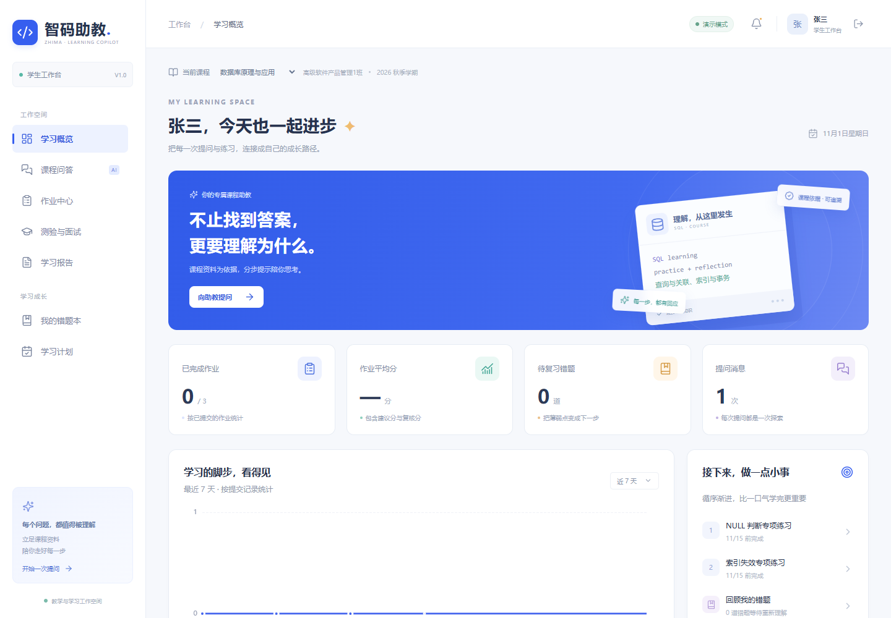
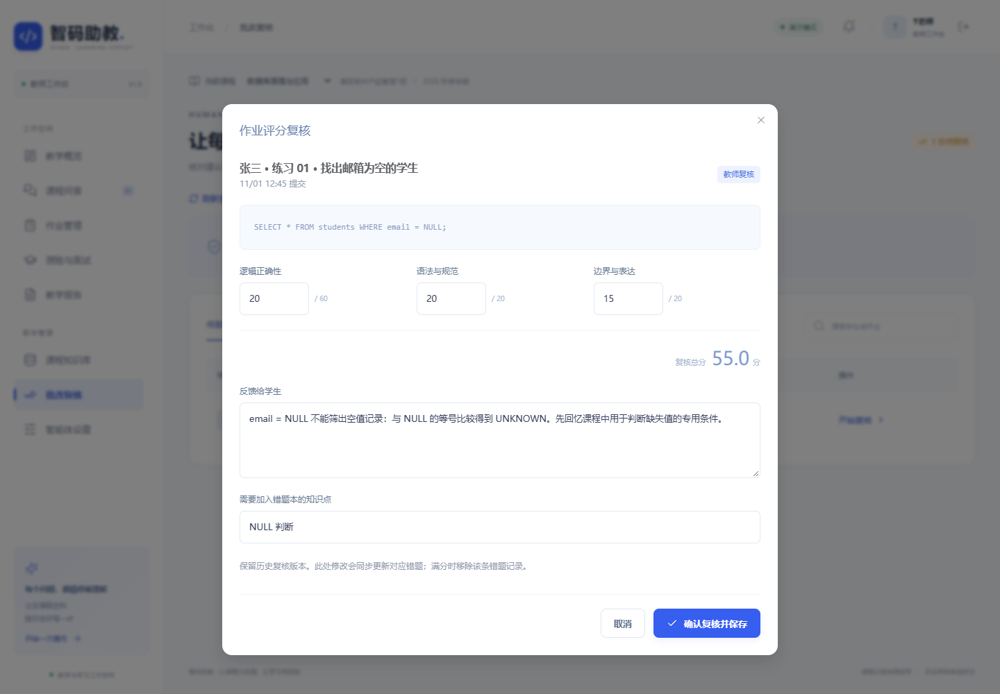

# 智码助教

面向数据库、Python、Java课程的教学智能体，串联课程资料、问答辅导、作业反馈、教师复核与复习记录。

**作者**：高炳旭　**学号**：S202688265　**方向**：产品经理  
**课程**：高级软件产品管理　**版本**：V1.0　**日期**：2026年11月1日

## 产品入口

- 本机工作台：http://127.0.0.1:8765 ，需先在当前电脑启动服务。
- 本机API文档：http://127.0.0.1:8765/api/docs 。
- 现有云端站点：[智码助教云端工作台](https://zhima-learning-full-20261031.ttt162521.chatgpt.site)，历史部署为仅所有者可见；访问权以实际设置为准。
- GitHub源码：[BSikunn/zhima-teaching-assistant](https://github.com/BSikunn/zhima-teaching-assistant)（私有仓库，需获授权的GitHub账号访问）。

## 面向谁

| 角色 | 可以完成的工作 |
| --- | --- |
| 学生 | 课程问答、来源核对、代码提交、反馈查看、错题复习、学习计划、测验、逐轮面试、个人报告 |
| 教师 | 上传课程资料、发布作业和评分标准、复核建议分、设置辅导方式、查看课程学情与报告 |
| 管理员 | 查看用户列表、探测服务状态，并通过项目维护脚本管理运行环境 |

## 核心流程

教师整理并上传课程材料 → 学生围绕当前课程提问 → 查看回答依据 → 独立提交代码 → 获取建议批改 → 教师复核 → 错题与复习计划 → 测验或面试 → 学习与教学报告。



配图来自2026年11月1日的独立演示环境，页面中的规则反馈和样例分数不代表真实模型输出或教学效果。

## 主要功能

1. **课程知识库**：本机支持PDF、PPTX、DOCX、TXT、MD、SRT、VTT，单文件20MB；保留页码、段落或字幕位置。扫描PDF需先做OCR。30份扩充中文讲义放在`resources/course-library`。
2. **带依据问答**：课程资料优先，可按需使用实际网页摘要；课程、网页和模型知识分别标注。无相关资料时，DeepSeek模式可以继续回答通用问题；网络或模型故障如实展示。
3. **分步辅导**：先给学习线索，再逐层展开；教师控制最高提示级别。
4. **作业与复核**：学生提交、异步建议评分、教师分维度复核、版本记录与错题同步；模型建议不等于最终确认成绩。
5. **学习闭环**：按课程保存错题、复习计划、1至5题测验、逐轮面试及报告；报告可下载为UTF-8 Markdown。
6. **代码试运行**：代码与标准输入交给Judge0远程沙箱，执行结果与评分分别保存。SQL实例为SQLite，MySQL专有语法不保证兼容。
7. **实际服务探测**：展示探测时间与真实运行方式；存在配置不等于服务已成功连通。



## 三种运行方式

| 项目 | 本机实现 | 容器方案 | Sites云端适配 |
| --- | --- | --- | --- |
| 界面 | Vue 3、TypeScript、Element Plus、ECharts | 同一前端，经Nginx提供 | Vue界面 |
| 业务 | FastAPI、SQLAlchemy | Python 3.11、FastAPI | Worker服务 |
| 数据 | SQLite，已有Python 3.12环境 | MySQL 8 | D1 |
| 任务 | Redis 7、Celery线程worker | Linux Celery worker | D1持久任务状态与租约 |
| 文件 | MinIO或本地模式 | MinIO | R2及受保护的初始文件模块 |
| 检索 | LlamaIndex、BGE、Chroma | 独立向量索引服务 | 课程全文排序 |
| 外部能力 | DeepSeek、网页搜索、Judge0 | 同类服务 | DeepSeek、网页搜索、Judge0 |

云端与本机具有独立数据，不提供自动双向同步。源码包交付本机完整实现及容器配置；现有Sites适配源码保留在原项目`sites/zhima-cloud-v3`中。容器方案还需要在可用Docker主机进行完整运行验收。

## 从源码开始

前置条件：已有Python 3.11或3.12、Node.js及npm。首次安装会下载Python依赖、前端依赖和BGE模型，需要联网并预留相应磁盘空间。

```powershell
# 在解压后的项目根目录执行；将解释器路径改为本机已有Python
powershell -ExecutionPolicy Bypass -File .\scripts\install.ps1 -Python "C:\Python312\python.exe"
Copy-Item -LiteralPath .env.example -Destination .env
```

`.env.example`默认为`AI_MODE=demo`、`TASK_MODE=eager`及本地文件模式，适合先检查流程，不调用付费模型。需要真实能力时，由维护人员在私有`.env`中设置`AI_MODE=deepseek`、`DEEPSEEK_API_KEY`、`DEEPSEEK_MODEL`等。密钥只由后端读取，不能放入前端或仓库。

双击`启动智码助教.cmd`打开本机系统，使用后双击`停止智码助教.cmd`。要重现当前原电脑的完整Redis/Celery、MinIO和向量索引服务，需按脚本和运行维护说明配置；源码不会携带原电脑的服务凭据。

```powershell
. .\scripts\env.ps1
.\.venv\Scripts\python.exe scripts/import-course-library.py
# 检查清单后，按原项目维护步骤备份、停止API和worker，再执行带--apply的导入
```

新安装会创建基础课程及讲义；30份扩充讲义需要显式导入。无需把原电脑数据库和上传目录复制到GitHub。

## 体验账号

| 用户 | 账号 | 初始密码 |
| --- | --- | --- |
| 张三 | student | Demo12345! |
| 李四 | student2 | Demo12345! |
| 王五 | student3 | Demo12345! |
| T老师 | teacher | Demo12345! |
| 管理员 | admin | Demo12345! |

这些账号用于受控教学体验。正式开放前需建立真实身份、账号分发及课程授权机制，不能直接把体验密码作为多人生产方案。

## 源码结构

```text
backend/app/             接口、业务、权限、检索、模型及工具服务
backend/tests/           后端测试
frontend/src/            Vue三角色界面
resources/course-library/  三课程30份扩充讲义与清单
scripts/                 安装、启动、停止、导入、备份和验证
deploy/                  Docker Compose、Dockerfile、Nginx
docs/images/             产品操作配图
.env.example             不含真实密钥的配置示例
README.md                安装入口与运行说明
产品说明.md               本文件
```

## 验证

2026年11月1日本机重新执行：后端139项测试通过，1条上游弃用警告；前端类型检查与生产构建通过，存在构建包较大提示。使用独立演示数据库生成16张操作配图，不改动真实学习数据，不调用付费模型。

```powershell
. .\scripts\env.ps1
.\.venv\Scripts\python.exe -m pytest -q --basetemp=.cache/pytest-check
npm.cmd run build --prefix frontend
```

2026年10月31日的项目记录另载真实AI、向量、队列、对象存储及三语言远程执行验证；这些是历史结果，不保证外部服务长期可用。软件测试通过也不代表教学效果、并发容量或商业收益已经验证。

## 数据与维护边界

- 上传源码时排除私有`.env`、数据库、上传资料、备份、日志、依赖目录、模型权重和运行工具。仓库只保留配置示例及可重新安装的依赖清单。
- 问答和批改可能向DeepSeek发送必要课程上下文；联网补充发送简短问题；程序执行向远程Judge0发送代码与标准输入。上传前核对材料的使用权限。
- 原始音视频转写、语音问答、多智能体、支付和学校系统集成不属于已验收范围。
- 本机Celery线程方案适合课程原型；正式生产使用Linux部署并完成集成、容量和恢复验证。公开沙箱、搜索和存储软件的维护变化需要持续评估。
- 模型输出可能出错，引用需核对，关键评价由教师确认；手动标记复习完成不代表已掌握。

## 技术资料

- [RAG原始研究](https://arxiv.org/abs/2005.11401)
- [FastAPI官方文档](https://fastapi.tiangolo.com/)
- [BGE官方模型说明](https://huggingface.co/BAAI/bge-small-zh-v1.5)
- [DeepSeek接口文档](https://api-docs.deepseek.com/)

仓库发布不自动授予第三方课程资料的再分发许可。需要开源许可时，应由作者确认许可方式并核对依赖及资料来源。
